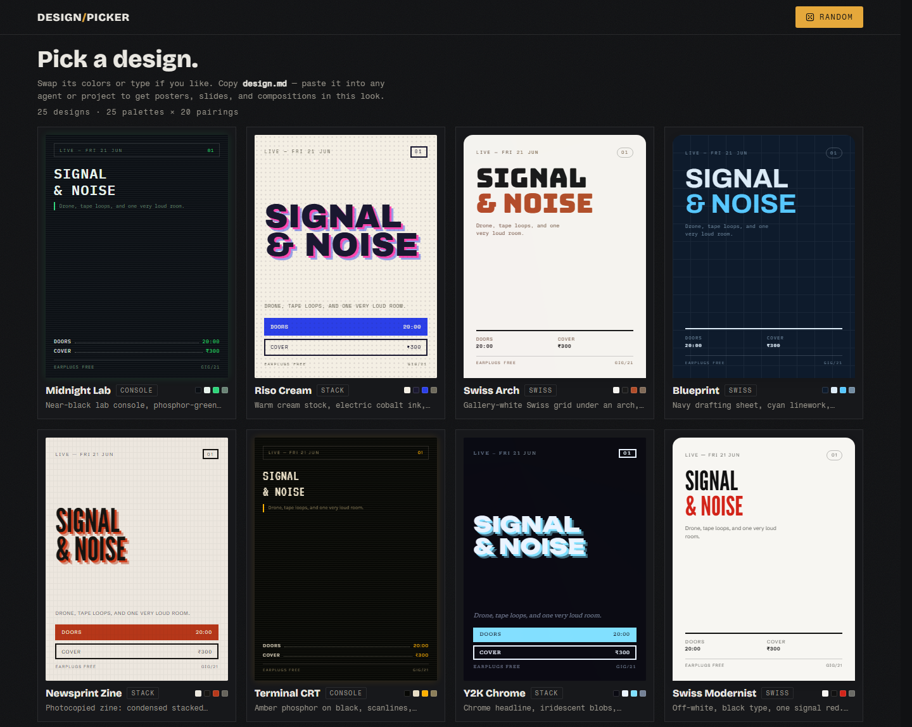
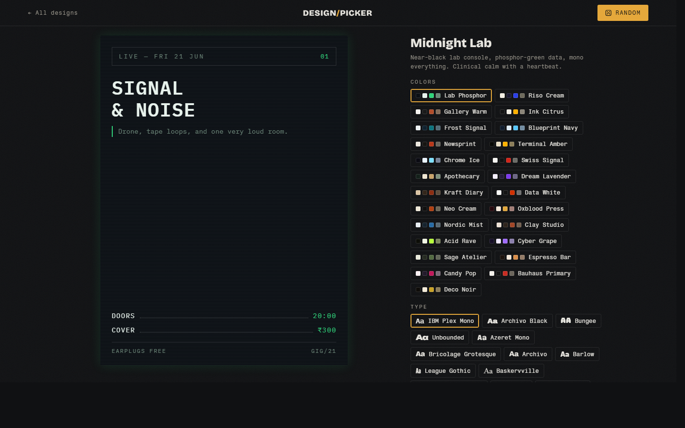

# Design Picker

A catalog of 25 visual Designs — composed recipes of color, type, and layout — for AI-generated posters, slides, and compositions. Browse live previews, swap a Design's palette or type pairing until it clicks, then copy `design.md` into any agent or project. Everything you make with it comes out in the same look.

Static site: Python at build time, vanilla HTML/CSS/JS at runtime. Zero dependencies.





## Run

```sh
python build.py                 # generates dist/
python -m http.server -d dist   # open http://localhost:8000
```

## Structure

- `data/designs.py` — the catalog: 25 designs, 25 palettes, 20 pairings, 8 textures
- `build.py` — validates catalog references, computes palette contrast ratios, emits `dist/`
- `site/` — page shell, styles, runtime logic
- `CONTEXT.md` — domain glossary

## License

[MIT](LICENSE)
